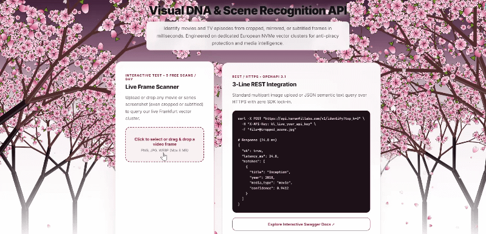

# Karanfil Labs — Visual DNA API Quickstart

Identify movies and TV series episodes from any single video frame (or natural-language scene description) in milliseconds. All frames are processed in **volatile RAM** (768-d CLIP fingerprinting) with zero file storage.


- **Live Demo (No Sign-Up):** Try 5 free scans/day at [karanfillabs.com](https://karanfillabs.com)
- **Free Developer Tier:** Sign up for **50 free API scans** and get your `X-API-Key`

## 30-Second cURL Test

### 1. Identify a Movie/Series from a Frame (`POST /v1/identify`)
```bash
curl -X POST "https://api.karanfillabs.com/v1/identify?top_k=5&min_score=0.70" \
  -H "X-API-Key: kl_live_YOUR_API_KEY" \
  -F "file=@sample_frame.jpg"
```

### 2. Semantic Scene Search by Text (`POST /v1/search`)
```bash
curl -X POST "https://api.karanfillabs.com/v1/search" \
  -H "X-API-Key: kl_live_YOUR_API_KEY" \
  -H "Content-Type: application/json" \
  -d '{"query": "rainy neon cyberpunk street at night", "top_k": 5}'
```

### Example Response
```json
{
  "ok": true,
  "latency_ms": 48.2,
  "matches": [
    { "title": "Blade Runner 2049", "score": 0.91 }
  ],
  "quota": {
    "plan": "free",
    "remaining_quota": 49
  }
}
```

## Examples Included
- `python/identify_and_search.py` — Frame identification & semantic text search
- `nodejs/identify_and_search.mjs` — Zero-dependency Node.js 18+ example
- `bots/telegram_scene_bot.py` — Send a screenshot to identify the movie/episode
- `bots/discord_scene_bot.py` — `!identify` command bot with rich embed responses
